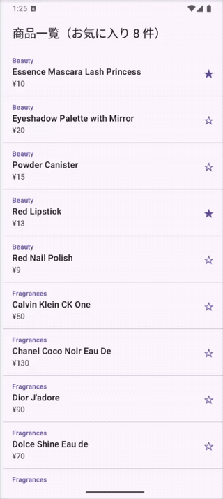

# MyKMP

Kotlin Multiplatform（KMP）で Android と iOS のロジックを共有する商品アプリです。
UI は各 OS のネイティブ（Android: Jetpack Compose / iOS: SwiftUI）で書き、それより下は `shared` モジュールで共有しています。

## デモ（Android）

一覧から商品を開き、詳細画面でお気に入りに登録して一覧に戻ると、★ とお気に入り件数が一覧にも反映されます。



## 技術スタック

| 用途 | ライブラリ | バージョン |
| --- | --- | --- |
| 言語 | Kotlin | 2.4.21 |
| 非同期 | kotlinx.coroutines（Flow） | 1.11.0 |
| 通信 | Ktor Client（Android: OkHttp / iOS: Darwin）＋ kotlinx.serialization | 3.6.1 |
| DB | SQLDelight | 2.4.1 |
| DI | Koin | 4.2.2 |
| Swift 連携 | SKIE（Flow → AsyncSequence、sealed → enum） | 0.10.16 |
| Android UI | Jetpack Compose / Material3 | Compose Multiplatform 1.12.2 |
| Android 画面遷移 | Navigation Compose | 2.10.0 |
| Android 画像 | Coil 3 | 3.6.3 |
| iOS UI | SwiftUI | - |

## アーキテクチャ

### 3 つの層

```
┌──────────────────────────┐   ┌──────────────────────────┐
│ androidApp（Compose）    │   │ iosApp（SwiftUI）        │
│  Screen ─▶ ViewModel     │   │  View ─▶ Observable      │
└────────────┬─────────────┘   └────────────┬─────────────┘
             └──────────────┬───────────────┘
                            ▼ Store を持つ
┌─────────────────────────────────────────────────────────┐
│ shared                                                  │
│                                                         │
│  presentation   Store / Processor / Reducer（MVI）      │
│        │                                                │
│        ▼ UseCase を呼ぶ                                  │
│  domain         UseCase / Repository（インターフェース）  │
│        ▲          / model                               │
│        │ インターフェースを実装                            │
│  data           RepositoryImpl / DataSource / mapper    │
│                   │                    │                │
└───────────────────┼────────────────────┼────────────────┘
                    ▼                    ▼
            DummyJSON API（Ktor）   SQLite（SQLDelight）
```

| 層 | 役割 | 主な中身 |
| --- | --- | --- |
| presentation | 画面の状態を管理する（MVI） | `mvi/`（共通の土台：Store / Processor / Reducer）、画面ごとのフォルダ（`productlist/`、`productdetail/`） |
| domain | アプリのルール。他の層やライブラリに依存しない | `model/`、`repository/`（インターフェース）、`usecase/`、`DomainResult` |
| data | データの取得と保存 | `datasource/remote`（Ktor）、`datasource/local`（SQLDelight）、`model/`（DTO）、`mapper/`、`repository/`（実装） |

依存の向きは **`UI → presentation → domain ← data`** です。domain は data を知らず、data が domain のインターフェースを実装します。

### presentation 層の流れ

```
UI ──Intent──▶ Processor ──Action──▶ Reducer ──State──▶ UI
                  │
                  └──SideEffect──▶ UI（画面遷移・トーストなど 1 回きりのイベント）
```

| 役割 | 何をするか |
| --- | --- |
| Intent | ユーザーがしたいこと（UI から届く） |
| Processor | Intent を受けて UseCase を呼び、結果を Action / SideEffect として出す |
| Action | 実際に起きたこと（Store の内部だけで使う） |
| Reducer | 今の State と Action から次の State を作る、副作用のない関数 |
| State | 画面の状態（`StateFlow`） |
| SideEffect | 1 回だけ届けるイベント |

- 汎用の `Store<Intent, Action, State, SideEffect>` が全体をつなぎ、画面ごとには Processor と Reducer を書くだけにしている
- Store は Android の仕組みに依存しない。Android は `ViewModel` が `viewModelScope` で、iOS は `ObservableObject` が `storeScope()` で Store を持つ
