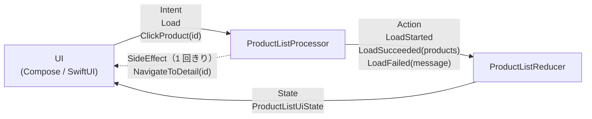

# ProductList の流れ

```
Intent ──▶ Processor ──Action──▶ Reducer ──State──▶ UI
               │
               └──SideEffect──▶ UI
```



| 役割 | ProductList での中身 |
| --- | --- |
| Intent | `Load`、`ClickProduct(id)` |
| Processor | `ProductListProcessor`：`GetProductsUseCase` を呼び、Action / SideEffect を出す |
| Action | `LoadStarted`、`LoadSucceeded(products)`、`LoadFailed(message)` |
| Reducer | `ProductListReducer`：State + Action → 次の State |
| State | `ProductListUiState`（`isLoading`、`products`、`errorMessage`） |
| SideEffect | `NavigateToDetail(id)` |
