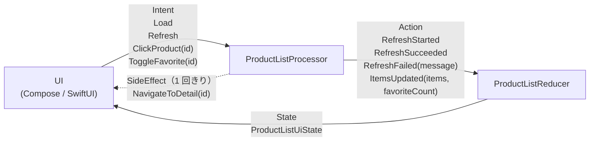

# ProductList の流れ

```
Intent ──▶ Processor ──Action──▶ Reducer ──State──▶ UI
               │
               └──SideEffect──▶ UI
```



## Intent ごとの処理

| Intent | 呼ぶ UseCase | 出す Action / SideEffect |
| --- | --- | --- |
| `Load`（最初に 1 回） | `ObserveProductsUseCase` と `ObserveFavoriteIdsUseCase` を **combine** して監視し続ける ＋ `RefreshProductsUseCase` | `ItemsUpdated`（DB が変わるたび）、`RefreshStarted` → `RefreshSucceeded` / `RefreshFailed` |
| `Refresh`（再読み込み） | `RefreshProductsUseCase` | `RefreshStarted` → `RefreshSucceeded` / `RefreshFailed` |
| `ToggleFavorite(id)` | `ToggleFavoriteUseCase` | なし（DB が変わり、監視中の combine から `ItemsUpdated` が流れる） |
| `ClickProduct(id)` | なし | SideEffect `NavigateToDetail(id)` |

## 複数の UseCase の combine / map

```kotlin
combine(observeProducts(), observeFavoriteIds()) { products, favoriteIds ->
    products.map { ProductListItem(product = it, isFavorite = it.id in favoriteIds) }   // 2 つを組み合わせる
}
    .distinctUntilChanged()
    .map { items -> ItemsUpdated(items, favoriteCount = items.count { it.isFavorite }) }  // 画面用の値を計算
```

どちらかの Flow に新しい値が来るたびに、両方の最新値で一覧が作り直される。
